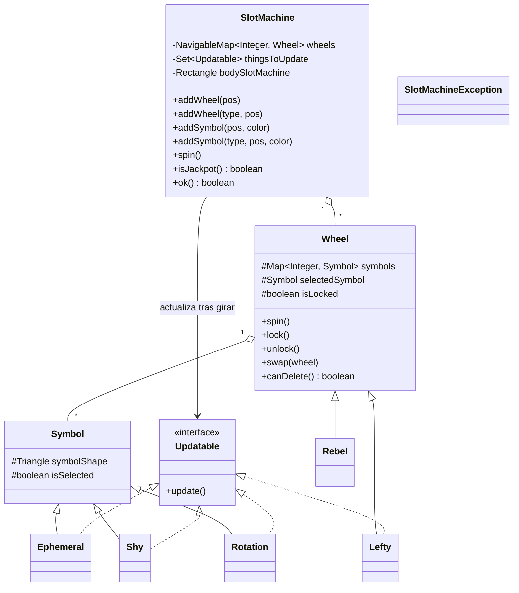

# 🎰 SlotMachine

**Simulador orientado a objetos de una máquina tragamonedas con ruedas y símbolos especiales.**
Proyecto de la asignatura DOPO-POOB 2026-2 · Java 17 · Maven · JUnit 5

Inspirado en el *Problema I: Slot Machine* del ICPC World Finals 2025 (Bakú).

---

## Tabla de contenido

1. [¿Qué es?](#qué-es)
2. [Características](#características)
3. [Estructura del proyecto](#estructura-del-proyecto)
4. [Arquitectura](#arquitectura)
5. [Ruedas y símbolos especiales](#ruedas-y-símbolos-especiales)
6. [API de `SlotMachine`](#api-de-slotmachine)
7. [Modo concurso (ICPC)](#modo-concurso-icpc)
8. [Cómo ejecutarlo](#cómo-ejecutarlo)
9. [Pruebas y calidad](#pruebas-y-calidad)
10. [Decisiones de diseño](#decisiones-de-diseño)
11. [Limitaciones conocidas](#limitaciones-conocidas)

---

## ¿Qué es?

`SlotMachine` modela una máquina con `n` ruedas. Cada rueda guarda un conjunto de símbolos identificados por **color** y, al girar, selecciona uno al azar. La máquina gana (**jackpot**) cuando todas las ruedas muestran el mismo color.

El proyecto ha crecido por ciclos. Empezó como un simulador básico (ciclo 1) y hoy incluye:

- ruedas y símbolos con comportamientos propios,
- bloqueo, intercambio y copia entre ruedas,
- una interfaz gráfica sencilla sobre el paquete `shapes`,
- una implementación de la estrategia del problema ICPC (`SlotMachineContest`).

## Características

- **Ruedas dinámicas:** se añaden, eliminan e intercambian en cualquier posición, y las demás se reacomodan solas.
- **Símbolos por color:** un color, una identidad.
- **Tipos especiales** creados por nombre de clase mediante reflexión, sin modificar `SlotMachine`.
- **Modo visible e invisible:** invisible sirve para pruebas y para resolver el problema del concurso sin ventana.
- **Reporte de estado con `ok()`:** cada operación indica si tuvo éxito.
- **Errores visuales:** los mensajes salen en `JOptionPane` solo si la máquina es visible.
- **Cobertura y análisis estático** con JaCoCo y PMD.

## Estructura del proyecto

```
SlotMachine/
├── Code/
│   ├── pom.xml                      # Java 17, JUnit 5, JaCoCo, PMD
│   ├── mvnw / mvnw.cmd              # Maven Wrapper
│   ├── lib/                         # JARs auxiliares (JUnit standalone)
│   ├── doc/                         # Javadoc generado
│   └── src/
│       ├── shapes/                  # Paquete gráfico de la Escuela
│       │   ├── Canvas, Figure
│       │   └── Rectangle, Triangle, Polygon2D
│       └── slotMachine/
│           ├── SlotMachine.java     # Clase principal (fachada)
│           ├── Wheel.java           # Rueda base
│           ├── Symbol.java          # Símbolo base (un Triangle coloreado)
│           ├── Updatable.java       # Contrato para elementos con efecto por giro
│           ├── SlotMachineException.java
│           ├── SlotMachineContest.java
│           ├── Lefty, Rebel         # Ruedas especiales
│           ├── Ephemeral, Shy, Rotation  # Símbolos especiales
│           └── test/                # Pruebas JUnit 5
├── Documents/                       # Especificaciones del curso
└── .vscode/                         # Configuración para VS Code
```

## Arquitectura



Puntos clave:

- **`SlotMachine` es una fachada.** Guarda las ruedas en un `TreeMap` cuya clave es la posición, empezando en 1.
- **`Updatable` desacopla los efectos.** Tras un giro, la máquina llama a `update()` sobre todo lo que lo implemente, sin conocer su tipo concreto.
- **Los tipos se resuelven por nombre.** `addWheel("Rebel", 2)` carga la clase con `Class.forName`, comprueba que herede de `Wheel` y la instancia.

## Ruedas y símbolos especiales

### Ruedas

| Clase | Comportamiento |
|---|---|
| `Wheel` | Rueda estándar: se puede bloquear, intercambiar y eliminar. |
| `Lefty` | **Copia** la rueda de su izquierda (símbolo elegido, símbolos y bloqueo) cada vez que se actualiza. No puede ir en la primera posición. |
| `Rebel` | **Indomable:** no se puede bloquear, intercambiar ni eliminar. Cualquiera de esos intentos lanza `SlotMachineException`. |

### Símbolos

| Clase | Comportamiento al actualizarse |
|---|---|
| `Symbol` | Triángulo de un color, sin efecto. |
| `Ephemeral` | Se encoge con cada actualización (`decrement()` de la figura). |
| `Shy` | Alterna su visibilidad cuando está seleccionado. |
| `Rotation` | Sube y baja 20 px cada vez que se actualiza. |

Para añadir un tipo nuevo basta con crear una subclase de `Wheel` o `Symbol` en el paquete `slotMachine`, con un constructor compatible, e implementar `Updatable` si tiene efecto por giro. `SlotMachine` no cambia.

## API de `SlotMachine`

**Construcción**

| Método | Descripción |
|---|---|
| `SlotMachine()` | Máquina vacía. |
| `SlotMachine(int n)` | Máquina con `n` ruedas, cada una con `n` símbolos de colores distintos (paleta hexadecimal de hasta 50 colores). |

**Ruedas**

| Método | Descripción |
|---|---|
| `addWheel(pos)` / `addWheel(type, pos)` | Inserta una rueda estándar o de un tipo dado. |
| `delWheel(pos)` | Elimina una rueda, salvo que esté bloqueada o sea `Rebel`. |
| `swap(a, b)` | Intercambia dos ruedas no bloqueadas. |
| `lock(w)` / `unlock(w)` | Bloquea o desbloquea una rueda. |

**Símbolos**

| Método | Descripción |
|---|---|
| `addSymbol(pos, color)` / `addSymbol(type, pos, color)` | Añade un símbolo normal o de un tipo dado. |
| `delSymbol(color)` | Elimina ese símbolo de todas las ruedas. |
| `placeSymbol(wheel, color)` | Deja visible un símbolo concreto en una rueda. |

**Giro**

| Método | Descripción |
|---|---|
| `spin()` | Gira todas las ruedas y luego ejecuta las actualizaciones. |
| `spin(wheel)` | Gira una rueda. |
| `spin(wheel, steps)` | Avanza una rueda `steps` posiciones (animado si es visible). |
| `spin(String[] config)` | Intenta fijar una configuración completa. |

**Consulta**

| Método | Descripción |
|---|---|
| `symbols()` | Colores de todas las ruedas, en orden. |
| `distinctSymbols()` | Cantidad de colores distintos. |
| `configuration()` | Colores visibles de izquierda a derecha. |
| `isJackpot()` | `true` si todas las ruedas muestran el mismo color. |
| `ok()` | Éxito de la última operación. |

**Visualización**

| Método | Descripción |
|---|---|
| `makeVisible()` / `makeInvisible()` | Muestra u oculta el simulador. |
| `frameFlickering()` | Refresca el dibujo. |
| `exit()` | Limpia la máquina y cierra la ventana. |

**Reglas de posición:** los índices empiezan en 1, y una posición fuera de rango se ajusta al límite más cercano.

### Ejemplo

```java
SlotMachine m = new SlotMachine();
m.addWheel(1);
m.addWheel(2);
m.addWheel("Rebel", 3);          // rueda que no se puede bloquear ni eliminar

for (int w = 1; w <= 3; w++) {
    m.addSymbol(w, "#FF0000");
    m.addSymbol(w, "#0000FF");
}
m.addSymbol("Rotation", 1, "#00FF00");   // símbolo que sube y baja

m.makeVisible();
m.spin();
System.out.println(Arrays.toString(m.configuration()));
System.out.println("Jackpot: " + m.isJackpot());
```

## Modo concurso (ICPC)

`SlotMachineContest` implementa una estrategia para el problema original: lograr `k = 1` símbolos distintos visibles (jackpot) moviendo ruedas, sin leer directamente su contenido.

```java
int[][] pasos = SlotMachineContest.solve(5);   // sin interfaz; devuelve los movimientos {rueda, giro}
SlotMachineContest.simulate(5);                // la misma estrategia, mostrada en pantalla
```

La estrategia tiene dos fases:

1. **`different`:** gira las ruedas buscando que `k` suba al máximo.
2. **`identical`:** alinea los símbolos de las demás ruedas con la rueda 1, registrando cuánto giró cada una para revertirlo al final.

## Cómo ejecutarlo

**Requisitos:** JDK 17 o superior. Maven es opcional porque el proyecto incluye el wrapper.

```bash
git clone https://github.com/SamuelVillagran/SlotMachine.git
cd SlotMachine/Code

./mvnw compile            # compila
./mvnw test               # ejecuta las pruebas y genera el reporte de JaCoCo
./mvnw pmd:check          # análisis estático (prioridad 2 o superior)
```

En Windows usa `mvnw.cmd` en lugar de `./mvnw`.

Para abrir la ventana del simulador, ejecuta `slotMachine.SlotMachine`, cuyo `main` crea la máquina y la muestra. Si usas **BlueJ**, abre la carpeta `Code/src` y crea objetos desde el panel.

> Las pruebas y la ejecución gráfica necesitan entorno con pantalla, o `-Djava.awt.headless=true` si la prueba no abre ventanas.

## Pruebas y calidad

Las pruebas están en `src/slotMachine/test/` y siguen los ciclos del curso:

| Archivo | Alcance |
|---|---|
| `SlotMachineC1Test` | Ciclo 1: ruedas, símbolos, giro, jackpot y visibilidad. |
| `SlotMachineC2Test` | Ciclo 2: extensiones y reglas añadidas. |
| `SlotMachineC4Test` | Ciclo 4: `Lefty` y `Rebel` (copiar, no bloquear, no intercambiar, no eliminar). |
| `WheelTest` | Comportamiento de la rueda de forma aislada. |
| `SlotMachineAceptanceTest` | Escenarios completos de extremo a extremo. |
| `Problem` | Pruebas sobre el problema del concurso. |

- **JaCoCo** genera el reporte de cobertura en la fase `test`.
- **PMD** revisa solo hallazgos de prioridad 1 y 2.

## Decisiones de diseño

- **Extensibilidad por polimorfismo y reflexión.** Nuevos tipos no obligan a editar `SlotMachine`.
- **`Updatable` como punto de enganche.** Cada elemento define su propio efecto.
- **Excepción propia.** `SlotMachineException` (no comprobada) comunica las reglas que rompen las ruedas especiales.
- **Posiciones tolerantes.** Ajustar al rango válido evita errores por un índice mal calculado.
- **`ok()` más diálogos opcionales.** El código llamador puede consultar el resultado, y el usuario ve el error solo si la máquina es visible.

## Limitaciones conocidas

Puntos detectados al revisar el código que conviene atender en próximos ciclos:

- `SlotMachine` declara `n`, `k` y `steps` como `static`, y el constructor sombrea `steps` con una variable local; esto puede causar errores si hay varias máquinas a la vez.
- `distinctSymbols()` cuenta los colores que aparecen **una sola vez** en toda la máquina, no los colores distintos visibles. Para esto último está el método privado `distinctSymbolsVisible()`.
- `isJackpot()` falla si ninguna rueda tiene un símbolo seleccionado (lista vacía).
- `lock(int)` termina con `isOk = false` incluso cuando bloquea con éxito.
- `Shy.update()` activa y desactiva la visibilidad en la misma llamada, por lo que el efecto neto es ocultar.
- `Lefty` revisa `positionWheel` dentro de su constructor, antes de que `SlotMachine` le asigne posición.
- El constructor `SlotMachineContest(int)` ignora su parámetro y usa el `n` estático.
- El repositorio incluye archivos generados (`.class`, `.ctxt`, `target/`); conviene añadirlos a `.gitignore`.

---

*Proyecto académico — DOPO-POOB 2026-2.*
Readme generado por Claude Sonnet 5.5
